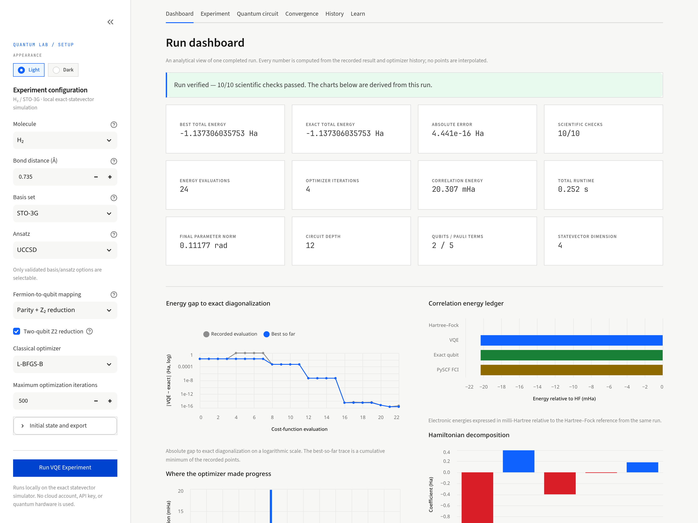
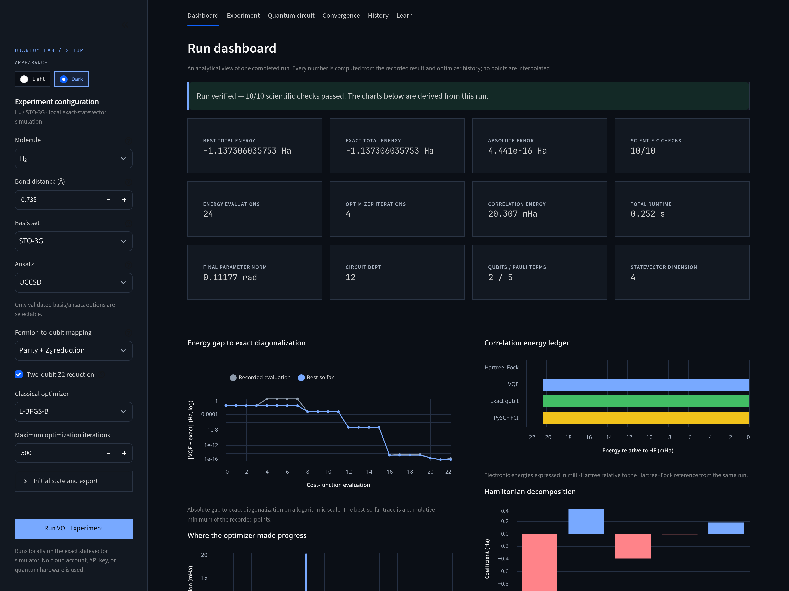

# Quantum VQE Chemistry Lab

[](https://github.com/Abdelhakim-Baalla/quantum-vqe-chemistry-lab/actions/workflows/ci.yml)
[](https://github.com/Abdelhakim-Baalla/quantum-vqe-chemistry-lab/blob/main/pyproject.toml)
[](LICENSE)
[](CITATION.cff)

A reproducible, open-source laboratory for **variational quantum eigensolver
(VQE)** experiments in quantum chemistry. The first experiment computes the
electronic ground-state energy of molecular hydrogen (H₂) in the STO-3G basis,
executes the variational calculation on a local exact-statevector simulator,
and validates it against exact diagonalization and an independent PySCF
full-configuration-interaction (FCI) calculation.

This is a scientific reference implementation, not a claim of quantum
advantage. Everything runs on a laptop; no IBM Quantum account, cloud service,
or quantum hardware is required. A local Streamlit dashboard, **Quantum Lab**,
exposes the same validated scientific layer for interactive configuration,
real circuit inspection, convergence analysis and JSON export.

## First result at a glance

The checked-in official run is documented in
[`docs/experiment_report.md`](docs/experiment_report.md), with the machine
readable result in
[`docs/assets/h2_result.json`](docs/assets/h2_result.json) and the convergence
plot in [`docs/assets/h2_result.png`](docs/assets/h2_result.png). Its measured
values are:

| Quantity | Value |
| --- | ---: |
| Status | **SUCCESS** |
| VQE total energy | **−1.1373060357533986 Ha** |
| Exact qubit total energy | −1.137306035753399 Ha |
| Independent PySCF FCI total | −1.1373060357534004 Ha |
| Absolute VQE error | **4.440892098500626 × 10⁻¹⁶ Ha** |
| Qubits / Pauli terms | 2 / 5 |
| UCCSD parameters | 3 |
| Optimizer evaluations / iterations | 24 / 4 |
| Converged | yes |

The run uses H₂ at **0.735 Å**, the **STO-3G** basis, **parity** mapping with
two-qubit Z2 tapering, a **UCCSD** ansatz with a Hartree–Fock reference,
**L-BFGS-B**, and Qiskit's exact **`StatevectorEstimator`** (no shots). It
computes its own numbers; no energy is hard-coded into the experiment.

This is a validation result, not a claim of quantum advantage: the two-qubit
Hamiltonian is classically trivial. The project demonstrates the complete
workflow and its independent checks, not hardware performance.

## Quick start

The project targets Python 3.11 and 3.12. The tested environment is Python
3.12.14. Create an isolated environment:

```bash
cd quantum-vqe-chemistry-lab
uv venv --python 3.12
source .venv/bin/activate
uv pip install -e ".[dev,web]"
```

With plain `pip`, the equivalent is:

```bash
python3.12 -m venv .venv
source .venv/bin/activate
python -m pip install --upgrade pip
python -m pip install -e ".[dev,web]"
```

The `dev` extra provides the test and lint tools. The `web` extra provides
Streamlit, pandas, Altair and `pylatexenc` for the local dashboard and its
circuit renderer. A CLI-only environment can use `.[dev]` instead.

Run the experiment:

```bash
python -m quantum_vqe run-h2 --distance 0.735 --basis sto3g --plot
```

The console prints the configuration, Hamiltonian and ansatz information,
Hartree-Fock and VQE energies, exact and PySCF FCI references, the absolute
error, optimizer convergence status, evaluation counts and wall-clock time. A
timestamped JSON file is written under `results/`, and `--plot` adds a PNG
convergence plot next to it.

Useful variants:

```bash
# Explicit output path and plot
python -m quantum_vqe run-h2 --json results/h2_0735.json --plot

# Jordan-Wigner mapping, no parity reduction (4 qubits instead of 2)
python -m quantum_vqe run-h2 --mapping jordan-wigner

# A different optimizer and a seeded random starting point
python -m quantum_vqe run-h2 --optimizer BFGS --tolerance 1e-6 --init random --seed 11
```

The installed entry point is equivalent to the module invocation:

```bash
quantum-vqe run-h2 --distance 0.735
```

## Quantum Lab web interface

Launch the local dashboard from the repository root:

```bash
streamlit run app.py
```

Streamlit prints a local URL, normally <http://localhost:8501>. The server is
intended for local use; do not expose it publicly without adding authentication
and transport security. No cloud account, API key or quantum hardware is used.

The interface keeps the approved editorial light theme as its default and adds
a session-level **Light/Dark** switch. Dark mode retints the CSS, Altair charts,
Matplotlib molecule and Qiskit circuit diagrams; scientific values are
unchanged. A fixed top-left control keeps the sidebar reopenable after collapse.

| Light | Dark |
| :---: | :---: |
|  |  |

*Both screenshots are from the app's own H₂ run. Values come from the app's
`ExperimentResult`, not from a design mock-up; the checked-in reference result is
documented in the table above.*

The dashboard provides:

- **Experiment configuration:** H₂, bond distance, validated basis/ansatz
  options, parity or Jordan–Wigner mapping, the five supported SciPy
  optimizers, iteration cap, initial-point mode, seed and an optional output
  directory.
- **Real execution:** a prominent **Run VQE Experiment** action calls the
  existing `quantum_vqe` pipeline. It does not duplicate the algorithm and does
  not invent energies or convergence data.
- **Diagnostics dashboard:** twelve run-derived metrics and six real-data views
  — log energy gap, step improvement, parameter trajectories, correlation
  energy ledger, Hamiltonian coefficients and parameter-correlation matrix —
  plus a validation/timing manifest. All panels are computed from the recorded
  optimizer history and result JSON.
- **Molecular information:** geometry, electrons, orbitals, qubit count,
  Hamiltonian terms, nuclear repulsion and a clearly labeled illustrative
  H–H geometry.
- **Quantum circuit explorer:** diagrams generated from the exact UCCSD ansatz
  object used by the run, with qubit count, depth, gate counts and the optimized
  parameters. Light and dark PNG variants are precomputed from the same circuit.
- **Energy results:** electronic and total energies kept separate, absolute
  error in Hartree and milli-Hartree, initial energy, evaluation count,
  convergence status and elapsed time.
- **Interactive convergence:** recorded cost-function evaluations with an exact
  reference line and a best-so-far trace. The chart and table contain only
  actual history points.
- **History and export:** completed session runs can be compared, saved as
  structured JSON under the selected output directory, or downloaded as JSON or
  CSV. No database is used.
- **Learning mode:** short explanations of qubits, molecular Hamiltonians,
  fermion-to-qubit mappings, parameterized circuits, classical optimization,
  exact diagonalization and why simulation is not hardware execution.

The interface calls the same `ExperimentConfig`, `build_chemistry` and
`run_h2_experiment` implementation as the CLI. The scientific package does not
import Streamlit. The Streamlit-independent UI helpers live in `webapp/`; the
scientific layer remains in `src/quantum_vqe/`.

Tests for the interface use Streamlit's `AppTest` and are described in
[`docs/web_interface.md`](docs/web_interface.md). They cover startup, form
validation, calls into the scientific layer, real-result display, failure
handling, error arithmetic, JSON export and a real H₂ run through the UI.

## What VQE does

A quantum chemistry problem can be written as a **Hamiltonian** \(\hat H\):
an operator whose eigenvalues are the allowed energies of the molecule. The
lowest eigenvalue is the ground-state energy.

VQE is a hybrid quantum/classical algorithm:

1. A quantum circuit prepares a parameterized state
   \(|\psi(\boldsymbol\theta)\rangle\).
2. The quantum simulator measures the expectation value
   \(E(\boldsymbol\theta)=\langle\psi(\boldsymbol\theta)|\hat H|\psi(\boldsymbol\theta)\rangle\).
3. A classical optimizer changes \(\boldsymbol\theta\) to lower \(E\).
4. Steps 2–3 repeat until convergence.

The variational principle says that for any normalized trial state,

\[
E(\boldsymbol\theta) \ge E_0,
\]

where \(E_0\) is the exact ground-state energy. A lower energy is therefore
better, and the exact result provides an independent certificate: a correct
VQE result cannot be below \(E_0\) beyond numerical noise. VQE is a heuristic;
it does not guarantee finding the global minimum, and its accuracy depends on
the ansatz and optimizer.

## The H₂ experiment

### 1. Molecular problem and integrals

The geometry is `H 0 0 0; H 0 0 0.735` with coordinates in Ångström. Qiskit
Nature's `PySCFDriver` runs a restricted Hartree-Fock (RHF) calculation with
PySCF and produces the one- and two-electron molecular-orbital integrals.

In second quantization, the electronic Hamiltonian is

\[
\hat H_{\mathrm{elec}} =
\sum_{pq} h_{pq} a_p^\dagger a_q
+ \frac12 \sum_{pqrs} h_{pqrs} a_p^\dagger a_q^\dagger a_r a_s ,
\]

where \(a_p^\dagger\) and \(a_p\) create and annihilate electrons in spin
orbital \(p\). The total molecular energy adds the classical nuclear repulsion:

\[
E_{\mathrm{total}} = E_{\mathrm{elec}} + E_{\mathrm{nuc}}.
\]

The experiment reports both. For H₂/STO-3G, \(E_{\mathrm{nuc}}\approx 0.72\)
Ha at 0.735 Å; the electronic energy is negative. Comparing a VQE electronic
energy to a total FCI energy without adding \(E_{\mathrm{nuc}}\) would be a
unit/definition mistake, so the JSON keeps the two quantities separate.

### 2. Fermions to qubits

Electrons are fermions; qubits are distinguishable two-level systems. A
**fermionic-to-qubit mapping** encodes occupation numbers in qubit states. This
project supports:

- **Jordan-Wigner (JW):** each spin orbital becomes one qubit and fermionic
  anticommutation is enforced with Pauli-Z strings.
- **Parity:** occupation parity is stored instead of occupation number. With
  the number of alpha and beta electrons fixed, two qubits can be removed by
  **Z2 symmetry tapering**.

The default H₂ run uses parity mapping with the two-qubit reduction. STO-3G
has two spatial orbitals, i.e. four spin orbitals:

```text
4 spin orbitals --parity--> 4 qubits --Z2 tapering--> 2 qubits
```

The removed qubits correspond to the total particle-number parity and the
alpha-spin parity. The Hartree-Fock sector fixes their eigenvalues, so the
reduced Hamiltonian is isospectral to the full Hamiltonian *within that
symmetry sector*. The experiment also diagonalizes the full four-qubit
Jordan-Wigner Hamiltonian as a cross-check. Use `--no-reduce` to simulate four
qubits with parity mapping, or `--mapping jordan-wigner` to compare mappings.

### 3. UCCSD ansatz

The default ansatz is **unitary coupled-cluster singles and doubles (UCCSD)**:

\[
|\psi(\boldsymbol\theta)\rangle =
e^{T(\boldsymbol\theta)-T^\dagger(\boldsymbol\theta)}
| \mathrm{HF}\rangle,
\qquad T = T_1 + T_2.
\]

The Hartree-Fock state is the reference determinant. The singles and doubles
excitations are mapped to qubit operators, and their angles are optimized. For
the reduced H₂ problem Qiskit Nature constructs three parameters (two singles
and one double). Brillouin's theorem makes the singles stationary at the RHF
reference, so the double excitation carries the correlation energy; the
optimizer keeps the singles near zero. UCCSD is chemically motivated and, for
this two-electron minimal-basis problem, can represent the exact ground state.

### 4. Local simulation and optimization

VQE evaluates the cost function with Qiskit's `StatevectorEstimator`. This is a
noiseless local simulator: it evolves the statevector exactly, so there is no
shot noise and no hardware error. The classical optimizer is SciPy's
`L-BFGS-B` by default, with finite-difference gradients. The implementation
records every energy evaluation, the initial and final parameters, the number
of function evaluations, and the optimizer's own convergence flag.

A run is labeled **success** only when the optimizer reports convergence and
all scientific checks pass. A converged run with an inaccurate energy is still
reported as failed. An unconverged run is never silently presented as success.

### 5. Exact validation

The primary reference is the exact lowest eigenvalue of the **same** qubit
Hamiltonian, obtained by sparse/dense Hermitian diagonalization. This isolates
the variational algorithm from chemistry and mapping choices.

Two further independent checks are performed:

- The same electronic Hamiltonian is mapped with **Jordan-Wigner** and
  diagonalized in the full Hilbert space. Its ground energy must match the
  parity-reduced result.
- A direct **PySCF RHF + FCI** calculation is run from the same geometry and
  basis, without using Qiskit Nature. Its total energy must match the exact
  qubit total energy. The Hartree-Fock energy from the ansatz at zero angles is
  also compared with the independent RHF energy.

These are consistency checks, not a proof that the chosen basis set is
physically complete. STO-3G is a minimal basis and is not quantitatively
accurate for real chemistry.

## Installation

### Requirements

- Linux, macOS, or Windows
- Python 3.11–3.12
- Prebuilt wheels for the tested Linux, macOS and Windows Python versions; no
  compiler is required when wheels are available. PySCF is installed through
  the `qiskit-nature[pyscf]` extra.
- No GPU, quantum cloud credentials, or network access at run time

### Dependencies

The tested versions are listed in the experiment report. The declared ranges
are intentionally compatible with current releases:

| Package | Role | Declared range |
| --- | --- | --- |
| `qiskit` | circuits, operators, primitives, exact statevector simulator | `>=2.1,<3.0` |
| `qiskit-nature[pyscf]` | chemistry problem, mappings, Hartree-Fock/UCCSD, PySCF driver | `>=0.8,<0.9` |
| `pyscf` | mean-field integrals and independent FCI reference | via Qiskit Nature extra |
| `numpy` | linear algebra and arrays | `>=2.0,<3.0` |
| `scipy` | optimizer and sparse diagonalization | `>=1.11,<2.0` |
| `matplotlib` | convergence plots and molecular schematic | `>=3.8,<4.0` |
| `streamlit` | local interactive dashboard | `>=1.66,<2.0` (`.[web]`) |
| `pandas` | dashboard tables and exports | `>=2.0,<3.0` (`.[web]`) |
| `altair` | interactive convergence chart | `>=5.0,<7.0` (`.[web]`) |
| `pylatexenc` | Qiskit Matplotlib circuit rendering | `>=2.10,<3.0` (`.[web]`) |
| `pytest`, `pytest-cov`, `ruff` | development and CI | `.[dev]` |

Qiskit Nature 0.8 is the current release used here. Older tutorials that call
`QubitConverter` or the removed `qiskit_nature.algorithms` VQE classes target
older APIs; this project uses the current `second_q` API and a small explicit
VQE loop.

## Running experiments

```bash
python -m quantum_vqe run-h2 [options]
```

| Option | Default | Meaning |
| --- | --- | --- |
| `--distance ANGSTROM` | `0.735` | H–H bond length |
| `--basis NAME` | `sto3g` | PySCF basis set |
| `--mapping {parity,jordan-wigner}` | `parity` | fermion-to-qubit mapping |
| `--reduce` / `--no-reduce` | reduction on for parity | two-qubit Z2 tapering |
| `--optimizer NAME` | `L-BFGS-B` | SciPy optimizer |
| `--max-iterations N` | `500` | optimizer iteration cap |
| `--tolerance TOL` | optimizer-specific | optimizer convergence tolerance |
| `--init {hf,random}` | `hf` | initial UCCSD angles |
| `--seed N` | `7` | seed for random initial angles |
| `--output-dir DIR` | `results` | directory for timestamped JSON |
| `--json PATH` | timestamped file | explicit JSON path |
| `--plot` | off | write a PNG convergence plot |

Examples:

```bash
python -m quantum_vqe run-h2 --distance 0.735 --basis sto3g --plot
python -m quantum_vqe run-h2 --mapping jordan-wigner --json results/h2_jw.json
python -m quantum_vqe run-h2 --optimizer SLSQP --max-iterations 200
```

The program is deterministic for the default Hartree-Fock start and exact
simulator. Random starts are reproducible when the seed is fixed.

## Examples

The CLI is the primary interface, but the experiment is also a normal Python
API. The checked-in example mirrors the full workflow without argparse:

```bash
python examples/run_h2.py
python examples/run_h2.py --distance 0.9 --optimizer BFGS
python examples/run_h2.py --mapping jordan-wigner --output-dir results/jw
```

It prints a short summary and writes a JSON result plus a convergence plot
under `results/`, which is ignored by git. The script is intentionally small:
it calls `run_h2_experiment`, saves the result, and plots the recorded
optimization history.

## Output fields

A JSON result contains:

- `experiment`, `schema_version`, `status`, `created_utc`
- `config`: resolved run configuration, including the chosen tolerance
- `molecule`: geometry, basis, charge, spin, orbital/electron counts, nuclear
  repulsion, qubit count
- `hamiltonian`: mapping, reduction description, Pauli terms, Hermiticity check
- `ansatz`: UCCSD, qubit count, parameter count and names, reference state
- `optimizer` and `simulator`: method and simulation assumptions
- `energies_hartree`: HF, VQE, exact-qubit and PySCF FCI energies, both
  electronic and total where applicable
- `errors_hartree`: absolute VQE error, signed variational gap, reference
  cross-check errors
- `checks`: booleans for Hermiticity, qubit consistency, convergence,
  variational principle, accuracy target and independent references
- `references`: exact diagonalization and FCI details
- `optimization`: history (evaluation number, energy, parameters), counts,
  convergence message, initial/final energies and parameters
- `timing_seconds`: phase timings
- `software`: Python and package versions
- `warnings` and `artifacts`

A minimal programmatic example:

```python
from quantum_vqe import ExperimentConfig, run_h2_experiment
from quantum_vqe.plotting import plot_convergence

config = ExperimentConfig(distance_angstrom=0.735, basis="sto3g")
result = run_h2_experiment(config)
print(result.status)
print(result.energies_hartree["vqe_total"])
print(result.energies_hartree["exact_qubit_total"])
result.save("results/h2.json")
plot_convergence(
    result.optimization["history"],
    "results/h2.png",
    exact_energy=result.energies_hartree["exact_qubit_electronic"],
    hf_energy=result.energies_hartree["hf_electronic"],
)
```

## Tests

Fast unit tests and the full chemistry integration tests are separated with the
`integration` marker.

```bash
# Full suite (unit + integration)
pytest -q

# Fast checks only, no PySCF chemistry pipeline
pytest -q -m "not integration"

# Chemistry pipeline and CLI only
pytest -q -m integration
```

Coverage and linting:

```bash
pytest --cov=quantum_vqe --cov-report=term-missing
ruff check .
ruff format --check .
```

The unit suite checks configuration validation, operator Hermiticity, exact
diagonalization, energy errors, estimator/statevector agreement, the VQE loop,
serialization, no-false-success status logic and the Streamlit-independent web
helpers. Integration tests run the actual H₂ pipeline, compare against FCI and
JW references, exercise the CLI, reload the JSON result, and run a real H₂
experiment through Streamlit's `AppTest` UI harness. In the tested environment
the suite reports **106 unit tests** and **17 integration tests** (123 total),
all passing, with 89% statement coverage for the `quantum_vqe` package. CLI
subprocess behavior and the server-side AppTest UI harness are tested directly
but are not attributed to that in-process coverage total.

The CI workflow in `.github/workflows/ci.yml` installs `.[dev,web]` and runs
linting, formatting checks, unit tests and the chemistry/UI integration tests
on Python 3.11 and 3.12. The web UI redesign commit `e66d21f` passed this
workflow on both Python versions in GitHub Actions run `40016418427`.

## Project layout

```text
quantum-vqe-chemistry-lab/
├── src/quantum_vqe/
│   ├── config.py        # validated, serializable experiment configuration
│   ├── chemistry.py     # PySCF → electronic problem → mapping → UCCSD
│   ├── hamiltonian.py   # Hermiticity, exact diagonalization, expectation values
│   ├── vqe.py           # explicit VQE loop and optimizer bookkeeping
│   ├── reference.py     # PySCF FCI and full-JW independent references
│   ├── experiment.py    # orchestration, checks and result assembly
│   ├── results.py       # JSON schema, save/load and validation
│   ├── plotting.py      # convergence plots
│   ├── cli.py           # `python -m quantum_vqe run-h2`
│   └── versions.py      # reproducibility metadata
├── app.py               # Streamlit entry point (`streamlit run app.py`)
├── webapp/
│   ├── logic.py         # validation, run orchestration and exports (no Streamlit)
│   ├── visuals.py       # actual-result charts, molecule and circuit artifacts
│   └── __init__.py
├── .streamlit/
│   └── config.toml      # local light editorial theme and privacy setting
├── tests/unit/          # fast tests, including web logic and AppTest UI wiring
├── tests/integration/   # real H2/PySCF/CLI and real UI-run tests
├── examples/            # programmatic examples
├── docs/                # methodology, architecture, web interface and experiment report
│   ├── assets/          # checked-in result, plots and light/dark UI screenshots
│   └── launch/          # final carousel, video, poster, copy and checksums
├── .github/
│   ├── ISSUE_TEMPLATE/  # bug and scoped-feature forms
│   ├── workflows/ci.yml
│   └── PULL_REQUEST_TEMPLATE.md
├── CONTRIBUTING.md
├── SECURITY.md
├── CITATION.cff
├── CHANGELOG.md
└── CODE_OF_CONDUCT.md
```

## What this demonstrates — and what it does not

**Demonstrated**

- A real molecular Hamiltonian generated from PySCF integrals through Qiskit
  Nature, with no hard-coded energies.
- A documented fermion-to-qubit mapping and a justified two-qubit symmetry
  reduction.
- A chemically motivated UCCSD circuit with a Hartree-Fock reference.
- A complete VQE optimization with recorded convergence and parameters.
- Independent validation against exact diagonalization, full Jordan-Wigner and
  PySCF FCI, including the variational principle and total-energy bookkeeping.
- A local Streamlit dashboard that exposes the same implementation for
  interactive runs, actual circuit inspection, convergence analysis and JSON
  export.
- Reproducible JSON, convergence plots, tests, CI and version metadata.

**Not demonstrated**

- Quantum advantage. The simulator is classical and exact; a classical
  diagonalization of this 2-qubit Hamiltonian is trivial.
- Hardware performance, shot noise, gate errors, decoherence or error
  mitigation.
- Predictive chemistry beyond the STO-3G minimal basis. H₂/STO-3G is a
  validation problem, not a benchmark against experiment.
- General molecular scaling. Larger active spaces, frozen cores, relativistic
  effects, excited states and real hardware need substantially more machinery.
- Global optimality of VQE on non-trivial Hamiltonians. The optimizer is local
  and the ansatz is fixed.
- Public deployment, multi-user authentication or remote access for the
  Streamlit dashboard. It is a local scientific interface, not a hosted
  service.
- QAOA Max-Cut or any second quantum algorithm. QAOA is documented as future
  work in [`docs/roadmap.md`](docs/roadmap.md), not implemented here.

## Launch media

The final launch package lives inside this repository under
[`docs/launch/`](docs/launch/). It is derived from the checked-in official run
and contains no synthetic results.

- [`docs/launch/carousel/Quantum_Lab_LinkedIn_Carousel.pdf`](docs/launch/carousel/Quantum_Lab_LinkedIn_Carousel.pdf)
  — 8-page, 4:5 LinkedIn document post.
- [`docs/launch/video/Quantum_Lab_Launch.mp4`](docs/launch/video/Quantum_Lab_Launch.mp4)
  — 53-second silent walkthrough (1080p, 25 fps) with a synthetic cursor,
  click emphasis, on-screen section captions and a closing CTA card.
- [`docs/launch/video/Quantum_Lab_Launch_poster.jpg`](docs/launch/video/Quantum_Lab_Launch_poster.jpg)
  — 1920 × 1080 thumbnail; optional captions are in
  [`Quantum_Lab_Launch.srt`](docs/launch/video/Quantum_Lab_Launch.srt).
- [`docs/launch/LINKEDIN_POST.md`](docs/launch/LINKEDIN_POST.md) — post copy,
  alt text, first comment, hashtags and posting guidance.
- [`docs/launch/README.md`](docs/launch/README.md) — asset map and build notes.
- [`docs/launch/MANIFEST.sha256`](docs/launch/MANIFEST.sha256) — checksums.

## Documentation

- [`docs/methodology.md`](docs/methodology.md): equations, mapping details,
  UCCSD, optimizer choices, exact references, tolerances and limitations.
- [`docs/experiment_report.md`](docs/experiment_report.md): the measured run,
  environment, commands, results, checks and interpretation.
- [`docs/architecture.md`](docs/architecture.md): module boundaries and data
  flow, including the web layer.
- [`docs/web_interface.md`](docs/web_interface.md): dashboard controls, local
  launch, UI architecture, test strategy and limitations.
- [`docs/roadmap.md`](docs/roadmap.md): extensions, including QAOA Max-Cut.

## Scientific references

- Peruzzo et al., “A variational eigenvalue solver on a photonic quantum
  processor,” *Nature Communications* 5, 4213 (2014).
  <https://doi.org/10.1038/ncomms5213>
- McArdle et al., “Quantum computational chemistry,” *Reviews of Modern
  Physics* 92, 015003 (2020). <https://doi.org/10.1103/RevModPhys.92.015003>
- Grimsley et al., “An adaptive variational algorithm for exact molecular
  simulations,” *Nature Communications* 10, 3007 (2019).
  <https://doi.org/10.1038/s41467-019-10988-2>
- Qiskit Nature documentation and getting started:
  <https://qiskit-community.github.io/qiskit-nature/getting_started.html>
- IBM Quantum learning, VQE:
  <https://qiskit.qotlabs.org/learning/courses/quantum-diagonalization-algorithms/vqe>
- IBM Quantum learning, quantum chemistry with VQE:
  <https://qiskit.qotlabs.org/learning/courses/quantum-chem-with-vqe/index>
- Qiskit documentation: <https://quantum.cloud.ibm.com/docs/>
- PySCF documentation: <https://pyscf.org/>
- OpenFermion and Qiskit Nature mapping conventions are described in the
  Qiskit Nature API docs:
  <https://qiskit-community.github.io/qiskit-nature/apidocs/qiskit_nature.second_q.mappers.html>

## Contributing, security and citation

- Read [`CONTRIBUTING.md`](CONTRIBUTING.md) for setup, verification commands and
  the scientific-integrity checklist.
- Report vulnerabilities privately according to [`SECURITY.md`](SECURITY.md).
- Citation metadata is in [`CITATION.cff`](CITATION.cff). If you use the
  software or the checked-in H₂ reference result, please cite the repository.
- Release history is in [`CHANGELOG.md`](CHANGELOG.md).

## License

MIT. See [`LICENSE`](LICENSE).
